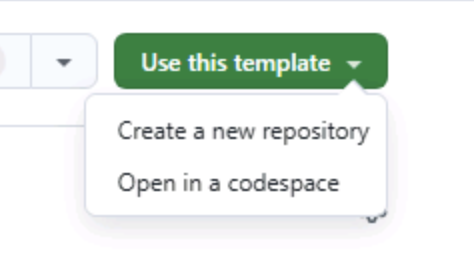

Copilot cloud agent 연습을 시작하기 전에 필요한 사항을 준비합니다. Tailspin Toys 리포지토리의 복사본을 만들고 [codespace][codespaces]를 시작합니다. 이 환경에서 지침 파일을 편집하고 cloud agent가 만든 결과를 검토합니다.

## 실습용 리포지토리 설정하기

코드를 작성할 리포지토리 복사본을 만들기 위해 [템플릿][template-repository]을 사용합니다. 새 리포지토리에는 실습에 필요한 모든 파일이 포함되며, 연습을 진행하는 동안 사용하게 됩니다.

1. 새 브라우저 창에서 [Tailspin Toys 템플릿][tailspin-template]으로 이동합니다.
2. 실습 리포지토리 페이지에서 **Use this template**을 선택한 다음 **Create a new repository**를 선택하여 리포지토리 복사본을 만듭니다.

    

3. GitHub 또는 Microsoft가 진행하는 행사에서 워크숍을 수행하는 경우 멘토의 안내를 따릅니다. 그렇지 않다면 GitHub Copilot을 사용할 수 있는 조직에 새 리포지토리를 만듭니다.

    

4. 나중에 참조할 수 있도록 생성한 리포지토리 경로(**organization-or-user-name/repository-name**)를 기록해 둡니다.

## Codespace 만들기

이제 Codespace에서 실습을 진행합니다.

[GitHub Codespaces][codespaces]는 브라우저에서 코드를 작성하고 실행하고 디버그할 수 있는 클라우드 기반 개발 환경입니다. 여러 프로그래밍 언어, 확장, 도구를 지원하는 완전한 기능의 IDE를 제공합니다.

1. 방금 만든 리포지토리로 이동합니다.
2. 녹색 **Code** 버튼을 선택합니다.

    

3. **Codespaces** 탭을 선택한 다음 **+** 버튼을 선택하여 새 Codespace를 만듭니다.

    

Codespace를 만드는 데 몇 분 정도 걸립니다. 그래도 모든 서비스를 수동으로 설치하는 것보다 훨씬 빠릅니다. 기다리는 동안 GitHub Copilot의 다른 기능을 살펴볼 수 있으며, 다음 단계에서 이어서 알아봅니다.

> [!CAUTION]
> 이후 연습에서 Codespace를 다시 사용합니다. 지금은 브라우저 탭에서 열린 상태로 둡니다.

> [!NOTE]
> 이 워크숍은 Codespace 또는 로컬 [dev container][dev-containers]에서 실행하도록 구성되어 있습니다. 두 환경 모두 원활하게 진행하는 데 필요한 사전 준비 항목을 제공합니다. 로컬에서 실행하려면 복제한 리포지토리를 VS Code에서 열고 메시지가 표시되면 **Reopen in Container**를 선택합니다. VS Code가 Codespace와 동일한 dev container를 빌드합니다.

[codespaces]: https://github.com/features/codespaces
[dev-containers]: https://code.visualstudio.com/docs/devcontainers/containers

## 요약

실습용 리포지토리의 복사본을 만들고 Codespace를 생성하기 시작했습니다. 이 환경에서 Copilot cloud agent와 함께 작업하게 됩니다.

## 다음 단계

cloud agent가 따를 사용자 지정 지침을 추가합니다. [연습 1 - 사용자 지정 지침][next-lesson]을 진행합니다.

## 리소스

- [GitHub Codespaces 개요][codespaces]
- [템플릿에서 리포지토리 만들기][template-repository]
- [Codespaces 시작하기][codespaces-quickstart]

[tailspin-template]: https://github.com/github-samples/tailspin-toys
[template-repository]: https://docs.github.com/repositories/creating-and-managing-repositories/creating-a-template-repository
[codespaces-quickstart]: https://docs.github.com/codespaces/getting-started/quickstart
[next-lesson]: ../1-custom-instructions/
